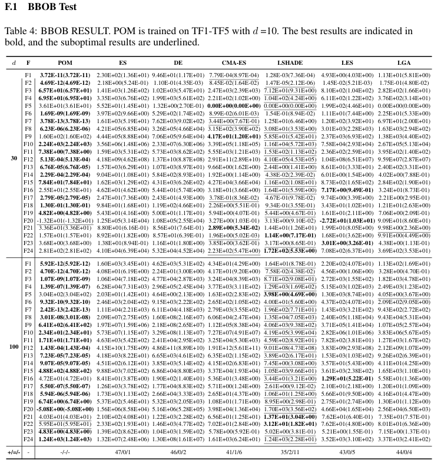

# POM

## Introduction

- 本仓库提供论文 **[Pretrained Optimization Model for Zero-Shot Black Box Optimization](https://proceedings.neurips.cc/paper_files/paper/2024/file/19e9a88d91917775b34fdad447ed8908-Paper-Conference.pdf)** 的复现实验代码，原作者仓库见 [ninja-wm/POM](https://github.com/ninja-wm/POM)。
- 原仓库公开了模型、检查点和推理代码，但没有提供完整的训练代码。因此，我们根据论文描述补充了训练框架，并整理训练和测试流程，建立本仓库用于自己的复现实验、方法对比，也为其他读者提供学习参考。
- 本仓库为独立维护的非官方版本，同时保留了使用作者公开 `ckpt` 获得的 BBOB 实测适应度及原始记录，欢迎使用和交流。

## Dependency Install

在项目根目录安装依赖：

```bash
conda create -n pom python=3.10
conda activate pom
pip install -r requirements.txt
```

依赖包括 PyTorch、NumPy、Matplotlib、SymPy、pandas 和 tqdm，版本要求见 [`requirements.txt`](requirements.txt)。以下命令使用 CUDA；使用 CPU 时，将 `--device cuda` 换成 `--device cpu`。

## Prepare Datasets

默认使用 TF1–TF5 训练，数据由 [`train/train.py`](train/train.py) 在线生成，无需额外下载。每个 epoch 重新采样任务平移量和初始种群，同一条优化轨迹内的任务参数保持固定；验证使用独立任务实例。

本地 BBOB F1–F24 问题描述保存在 [`platemo_bbob_problems/`](platemo_bbob_problems/)，对应的可导训练实现位于 [`train/problems.py`](train/problems.py)。作者权重测试所需的 D30/D100 参数和参考源码分别位于 `test/data/`、`test/reference/`。

## Model

模型位于 [`model/pom.py`](model/pom.py)，沿用作者公开网络的参数结构。默认采用 POM-M，共 202,329 个参数，兼容作者公开权重 `ckpt/pom_m_release.pth`。

```python
from model.pom import GB_GLHF

model = GB_GLHF(popsize=100, muthdim=1000, crhdim=4)
```

## Training

TF1–TF5 多任务共享训练：

```bash
python -m train.train --device cuda --output outputs/pom_train
```

默认设置为 D10、100 个体、每类函数 8 个任务实例、100 epoch、每轮 100 代，使用 Adam，学习率为 `1e-4`。每代平均各任务损失后更新一次共享模型，每个 epoch 后独立验证。训练配置、日志及 `weights.pth`、`last.pt`、`best.pt` 保存在指定输出目录。

本地 BBOB 的共享训练与逐题训练分别使用：

```bash
python -m train.train --taskset bbob --device cuda --output outputs/bbob_joint
python -m train.train_bbob --device cuda --output outputs/bbob_solo
```

更多设置可通过各入口的 `--help` 查看；实际实验参数以保存的 `config.json` 为准。

## Testing

使用作者公开权重及配套 BBOB 测试参数：

```bash
python -m test.compare_bbob --device cuda --dims 30 100 --runs 30 --output outputs/bbob_compare
```

加上 `--candidate outputs/pom_train/weights.pth` 可与自己训练的权重进行配对比较，也支持 `last.pt` 和 `best.pt`。请使用新的输出目录保存结果。

使用本地 PLATEMO 问题描述测试：

```bash
python -m test.evaluate_platemo --device cuda --dim 30 --runs 30 --output outputs/platemo_eval
```

作者测试协议使用 `[-10, 10]` 边界，本地 PLATEMO 当前使用 `[-5, 5]` 边界；两者的函数实现和参数分别管理。

## Results

**POM** 列为论文 [NeurIPS 2024 正式版附录 F.1、Table 4（第20页）](https://proceedings.neurips.cc/paper_files/paper/2024/file/19e9a88d91917775b34fdad447ed8908-Paper-Conference.pdf) 的报告值，**Ours** 列为我们使用作者公开检查点直接测试得到的结果。每次取最终种群的最佳适应度，再对 30 次独立运行求均值。**按两列均值的绝对值比较，绝对值较小者加粗**；差距按表中显示值计算：`Δ = abs(Ours) − abs(POM)`。

表格保留原始均值及正负号，加粗与差距均按上述绝对值口径计算。

### 30D

| Function | POM | Ours | 差距 Δ |
| :--- | ---: | ---: | ---: |
| F1 | 3.72E-11 | **1.31E-12** | -3.59E-11 |
| F2 | 4.69E-12 | **1.97E-14** | -4.67E-12 |
| F3 | 6.57E+01 | **8.54E-01** | -6.48E+01 |
| F4 | 6.95E+01 | **4.38E+01** | -2.57E+01 |
| F5 | 3.61E+01 | **7.45E+00** | -2.86E+01 |
| F6 | 1.69E-09 | **1.42E-10** | -1.55E-09 |
| F7 | **3.78E-13** | 3.30E-10 | +3.30E-10 |
| F8 | **6.23E-06** | 6.20E+00 | +6.20E+00 |
| F9 | 1.60E+02 | **1.42E+02** | -1.80E+01 |
| F10 | 2.24E+03 | **9.74E+02** | -1.27E+03 |
| F11 | **7.38E+00** | 2.04E+01 | +1.30E+01 |
| F12 | 5.13E-04 | **1.43E-05** | -4.99E-04 |
| F13 | 6.76E-05 | **2.65E-05** | -4.11E-05 |
| F14 | **2.29E-04** | 4.12E-04 | +1.83E-04 |
| F15 | **7.84E+01** | 1.13E+02 | +3.46E+01 |
| F16 | 2.55E+01 | **1.81E+01** | -7.40E+00 |
| F17 | **2.79E-05** | 2.21E-04 | +1.93E-04 |
| F18 | 1.30E-01 | **1.04E-02** | -1.20E-01 |
| F19 | **4.82E+00** | 5.25E+00 | +4.30E-01 |
| F20 | **-1.32E+01** | -1.90E+01 | +5.80E+00 |
| F21 | **3.36E+01** | 4.11E+01 | +7.50E+00 |
| F22 | **1.57E+01** | 3.29E+01 | +1.72E+01 |
| F23 | 3.68E+00 | **3.54E+00** | -1.40E-01 |
| F24 | **2.81E+02** | 3.25E+02 | +4.40E+01 |

### 100D

| Function | POM | Ours | 差距 Δ |
| :--- | ---: | ---: | ---: |
| F1 | **5.92E-12** | 6.32E-12 | +4.00E-13 |
| F2 | 4.70E-12 | **2.33E-13** | -4.47E-12 |
| F3 | **1.07E-09** | 6.67E-02 | +6.67E-02 |
| F4 | **1.39E-07** | 1.25E+00 | +1.25E+00 |
| F5 | **3.04E+02** | 3.33E+02 | +2.90E+01 |
| F6 | 9.32E-10 | **2.62E-10** | -6.70E-10 |
| F7 | 2.42E-13 | **1.30E-13** | -1.12E-13 |
| F8 | 3.01E-08 | **1.91E-08** | -1.10E-08 |
| F9 | 6.41E+02 | **6.34E+02** | -7.00E+00 |
| F10 | **2.34E+01** | 7.45E+01 | +5.11E+01 |
| F11 | **1.71E+01** | 6.50E+01 | +4.79E+01 |
| F12 | 1.43E-04 | **7.01E-05** | -7.29E-05 |
| F13 | 7.23E-05 | **5.99E-05** | -1.24E-05 |
| F14 | **9.07E-05** | 2.64E-04 | +1.73E-04 |
| F15 | **4.88E+02** | 5.20E+02 | +3.20E+01 |
| F16 | 4.72E+01 | **3.43E+01** | -1.29E+01 |
| F17 | **5.50E-07** | 6.98E-07 | +1.48E-07 |
| F18 | **5.94E-06** | 6.06E-06 | +1.20E-07 |
| F19 | **6.74E+00** | 7.34E+00 | +6.00E-01 |
| F20 | **-5.08E+00** | -8.06E+00 | +2.98E+00 |
| F21 | **4.03E+01** | 5.41E+01 | +1.38E+01 |
| F22 | **5.95E+01** | 7.27E+01 | +1.32E+01 |
| F23 | **4.83E+00** | 5.01E+00 | +1.80E-01 |
| F24 | **1.24E+03** | 1.32E+03 | +8.00E+01 |

### Paper Results



来源：[NeurIPS 2024 正式论文，附录 F.1，Table 4](https://proceedings.neurips.cc/paper_files/paper/2024/file/19e9a88d91917775b34fdad447ed8908-Paper-Conference.pdf)。

测试使用 RTX 4090、PyTorch `2.1.2+cu118`、NumPy `1.24.4` 和 `float32`，基础种子为 `2026`。每次运行 100 个体、100 代，包含初始化共 10,100 次函数评估；共保留 1,440 次运行记录。F20 保留作者源代码的随机、种群耦合行为，比较时使用同一目标实现。

原始测试过程与结果保存在 [`outputs/official_bbob/`](outputs/official_bbob/)：

- [`traces.csv`](outputs/official_bbob/traces.csv)：逐代过程日志，包含维数、函数、运行编号、种子、代数、评估次数和最佳适应度；每次运行记录第0–100代，共145,440条。
- [`per_run.csv`](outputs/official_bbob/per_run.csv)：1,440次独立测试的初始/最终适应度、种子与预算；[`curves.npz`](outputs/official_bbob/curves.npz) 保存相同的逐代轨迹数组。
- [`config.json`](outputs/official_bbob/config.json)、[`results.json`](outputs/official_bbob/results.json) 和 [`best_solutions.npz`](outputs/official_bbob/best_solutions.npz)：运行配置、完整精度汇总统计和最优解坐标。

表格保留三位有效数字，原始过程记录和结果文件原样保留。

这些数据来自实际服务器运行，48 组汇总结果已与逐次记录核对，均值、总体标准差和中位数一致，可用于相应测试设置下的复现验证、实验比较和学习研究。原始文件保留了当时运行的环境与源码版本信息，方便自行核查。

## Citation

使用本仓库开展研究时，欢迎引用原论文并注明实际实验配置。感谢原作者公开模型、权重和测试资源。

```bibtex
@inproceedings{NEURIPS2024_19e9a88d,
  title={Pretrained Optimization Model for Zero-Shot Black Box Optimization},
  author={Li, Xiaobin and Wu, Kai and Li, Yujian Betterrest and Zhang, Xiaoyu and Wang, Handing and Liu, Jing},
  booktitle={Advances in Neural Information Processing Systems},
  volume={37},
  year={2024},
  url={https://proceedings.neurips.cc/paper_files/paper/2024/file/19e9a88d91917775b34fdad447ed8908-Paper-Conference.pdf}
}
```

## Contact

欢迎大家使用本仓库并分享复测结果和改进建议。如在安装、训练、测试或数据使用中遇到问题，可以通过本仓库的 Issues 与我们联系，附上运行命令、环境版本和相关日志即可。
